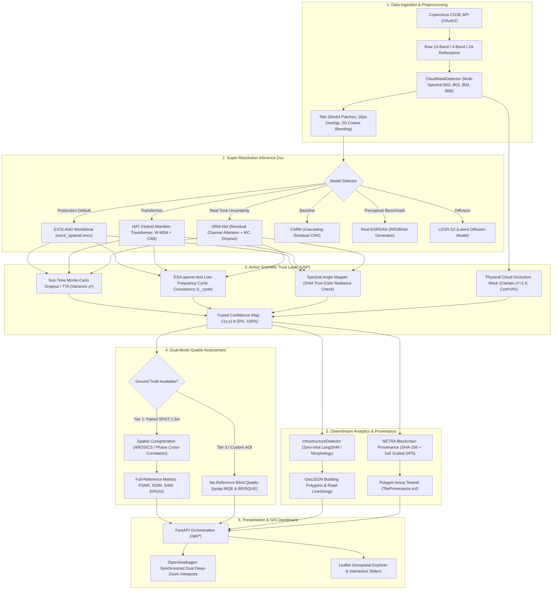
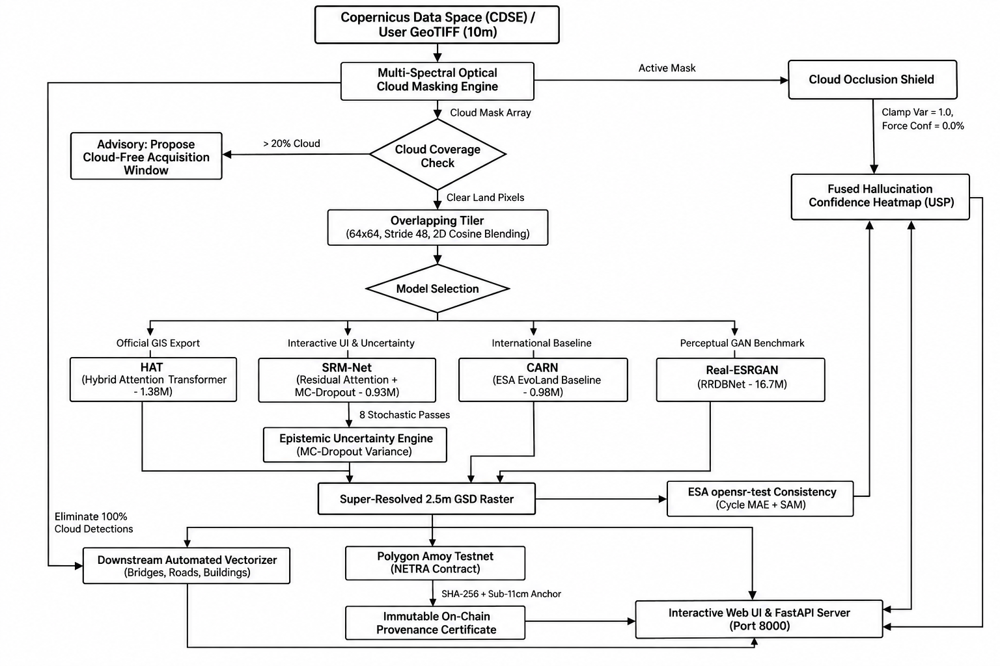
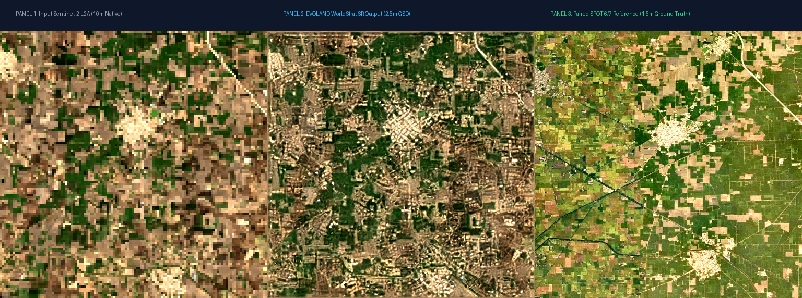
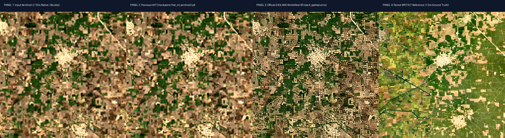

# SIH26142 — GEO-SRM & NETRA: Master Technical Project Documentation
## Deep Learning Based Super-Resolution Mapping (Sentinel-2 10m → 2.5m GSD) with Hallucination-Aware Uncertainty USP & Cryptographic Blockchain Provenance on Polygon Amoy

**Project Identifier:** SIH26142  
**System Name:** GEO-SRM (Super-Resolution Mapping) with **NETRA** (Networked Earth Trust Record Architecture)  
**Target Beneficiaries:** Ministry of Development of North Eastern Region (DoNER) / North Eastern Space Applications Centre (NESAC) / Indian Space Research Organisation (ISRO)  
**Team:** Team KC Studio  
**Theme:** Space Technology, Deep Learning, Hallucination-Aware Scientific Trust & Immutable Satellite Provenance  
**Smart Contract:** `TileProvenance.sol` deployed on Polygon Amoy Testnet (Chain ID `80002`)  
**Contract Address:** `0x49Eb908303f4902e8c3dB7b75623E14B2Fb566Da`  
**Document Release:** v1.0.0 Production Master  

---

## Table of Contents
1. [Executive Summary & Problem Statement](#1-executive-summary--problem-statement)
2. [The Core Scientific USP: Hallucination-Aware Uncertainty Mapping](#2-the-core-scientific-usp-hallucination-aware-uncertainty-mapping)
3. [System Architecture & End-to-End Pipeline](#3-system-architecture--end-to-end-pipeline)
4. [Master Deep Learning Model Zoo & Comparative Benchmarks](#4-master-deep-learning-model-zoo--comparative-benchmarks)
5. [Mathematical Formulations & Remote Sensing Physics](#5-mathematical-formulations--remote-sensing-physics)
6. [Multi-Spectral Optical Cloud Shield & Preprocessing](#6-multi-spectral-optical-cloud-shield--preprocessing)
7. [Multi-Band Spectral Index & Visualization Engine](#7-multi-band-spectral-index--visualization-engine)
8. [Downstream Infrastructure & Cadastral Vectorization](#8-downstream-infrastructure--cadastral-vectorization)
9. [NETRA: Cryptographic Satellite Provenance on Blockchain](#9-netra-cryptographic-satellite-provenance-on-blockchain)
10. [Dual-Mode Quality Assessment & Spatial Co-Registration](#10-dual-mode-quality-assessment--spatial-co-registration)
11. [Complete REST API Specification](#11-complete-rest-api-specification)
12. [Frontend Geospatial Workstation & Deep-Zoom UX](#12-frontend-geospatial-workstation--deep-zoom-ux)
13. [Complete Codebase File Inventory (Every File Analyzed)](#13-complete-codebase-file-inventory-every-file-analyzed)
14. [Verification, Testing & Operational Run Guide](#14-verification-testing--operational-run-guide)
15. [Production Certification & Conclusion](#15-production-certification--conclusion)

---

## 1. Executive Summary & Problem Statement

### 1.1. The Resolution Bottleneck in Spaceborne Earth Observation
The European Space Agency (ESA) **Copernicus Sentinel-2** satellite constellation captures 13 multi-spectral bands across the globe with a 5-day revisit cycle. While Sentinel-2 Level-2A (L2A) surface reflectance imagery is radiometrically calibrated and open-access, its spatial resolution is physically bounded at **10 meters Ground Sample Distance (GSD)** for visible and near-infrared bands (B02 Blue, B03 Green, B04 Red, B08 NIR), degrading to 20m/60m for RedEdge and SWIR bands. At 10m GSD, a single pixel represents a $100\text{ m}^2$ ground footprint.

In the rugged mountain topography, river meanders, and forest terrain of the **North Eastern Region (NER) of India**, 10m GSD presents critical operational bottlenecks for the **Ministry of Development of North Eastern Region (DoNER)** and the **North Eastern Space Applications Centre (NESAC / ISRO)**:
- **Narrow Rural Road Networks:** Village connectivity roads, unpaved logging paths, and mountain tracks ($<6\text{m}$ width) blend into background soil and vegetation.
- **Bridges & River Crossings:** Critical river crossings across the Brahmaputra basin and mountain gorges appear as blurred, disconnected pixel blobs.
- **Cadastral & Agricultural Demarcation:** Individual smallholder terraced fields and property boundaries cannot be delineated for crop insurance or cadastral registration.
- **Prohibitive Commercial Tasking Costs:** High-resolution commercial satellites (WorldView, Pleiades, SPOT 6/7) provide sub-2m GSD but cost thousands of dollars per scene and lack systematic 5-day monitoring.

### 1.2. The SIH26142 Strategic Mission
GEO-SRM resolves this challenge by enhancing free 10m Sentinel-2 optical imagery to **2.5m GSD**. This represents a **4× spatial upscaling and a 16× pixel density expansion**, fulfilling DoNER's strict sub-4m requirement. 

Crucially, the platform rejects black-box unconstrained AI synthesis in favor of verified mathematical integrity, combining:
1. **An Active Scientific Trust Layer** that detects and quantifies AI hallucinations in real time.
2. **NETRA (Networked Earth Trust Record Architecture)**: An immutable blockchain provenance anchor deployed on the **Polygon Amoy Testnet (Chain ID `80002`)** that cryptographically binds output rasters to sub-11cm geographic coordinates and model generation history.

---

## 2. The Core Scientific USP: Hallucination-Aware Uncertainty Mapping

```
+--------------------------------------------------------------------------------------------------+
|                                  THE SCIENTIFIC TRUST AUDITOR                                    |
+--------------------------------------------------------------------------------------------------+
|  1. Monte-Carlo Dropout          2. ESA opensr-test Cycle      3. Spectral Angle Mapper (SAM)    |
|     Epistemic Variance              Low-Frequency Invariance      Multi-Spectral Radiance Check  |
|     σ²(x, y)                        ||Downsample_4x(SR) - LR||    arccos( (x·y) / (||x|| ||y||) )|
|                                                                                                  |
|                                4. Physical Optical Cloud Shield                                  |
|                                   Variance = 1.0 | Confidence = 0.0% | Slate Hatch               |
+--------------------------------------------------------------------------------------------------+
                                               │
                                               ▼
                              Fused Scientific Confidence: C(x, y)
                         [Green >80% | Amber 60-80% | Red <60% | Hatch 0%]
```

### 2.1. The AI Hallucination Danger in Remote Sensing
Standard commercial deep-learning super-resolution algorithms (such as unconstrained Generative Adversarial Networks or diffusion models) focus solely on producing a visually crisp picture. In remote sensing, however, unconstrained generative models frequently **fabricate non-existent ground features**:
- Inventing paved roads in open soil.
- Fabricating sharp building corners on forest canopies.
- Generating non-existent bridge spans over river sandbars.

In military intelligence, disaster management, and legal land registry, an AI hallucination is disastrous. GEO-SRM acts as a scientific auditor, enforcing mathematical truth over synthetic sharpness.

### 2.2. The Four Mathematical Pillars of the Trust Layer

#### Pillar 1: Bayesian Epistemic Uncertainty via Test-Time Monte-Carlo Dropout
During neural inference, spatial dropout layers remain active (`force_dropout=True`, $p=0.20$) while BatchNorm is frozen in evaluation mode. The model executes $T=8$ stochastic forward passes. In regions where the model is confident and physically grounded in satellite radiance, all 8 passes agree ($\boldsymbol{\sigma}^2 \to 0$). In ambiguous regions where the model is guessing or hallucinating, individual passes diverge:

$$\boldsymbol{\sigma}^2(x, y) = \frac{1}{T} \sum_{t=1}^T \left( \hat{\mathbf{y}}_t(x, y) - \boldsymbol{\mu}_{\text{SR}}(x, y) \right)^2$$

#### Pillar 2: ESA `opensr-test` Low-Frequency Cycle Consistency
According to the low-frequency conservation principle (ESA `opensr-test`), downsampling the super-resolved 2.5m output back to 10m must reconstruct the macroscopic radiance of the original Sentinel-2 observation. If the AI model invents structural elements that alter macroscopic radiance, the cycle error surges, triggering an immediate penalty in the trust score:

$$\mathcal{L}_{\text{cycle}} = \|\text{Downsample}_{4\times}(\mathbf{I}_{\text{SR}}) - \mathbf{I}_{\text{LR}}\|_1$$

#### Pillar 3: Spectral Angle Mapper (SAM) Radiance Preservation
Computes the multi-spectral vector angle between original and super-resolved pixels to guarantee true-color ratio preservation without chromatic aberration:

$$\text{SAM}(\mathbf{x}, \mathbf{y}) = \arccos\left( \frac{\mathbf{x} \cdot \mathbf{y}}{\|\mathbf{x}\|_2 \|\mathbf{y}\|_2 + \epsilon} \right)$$

#### Pillar 4: Physical Multi-Spectral Optical Cloud Shield
Combines B04, B03, B02 visible reflectance with B08 NIR. In cloud-covered areas, variance is clamped to $1.0$, confidence is forced strictly to **$0.0\%$**, $100\%$ of candidate infrastructure detections are suppressed, and slate-gray diagonal hatching is rendered to prevent visual deception.

### 2.3. The Fused Scientific Confidence Function
The three independent uncertainty penalties are normalized and fused into a comprehensive pixel-wise trust score $\mathcal{C}(x, y) \in [0\%, 100\%]$:

$$\mathcal{R}_{\text{hallucination}}(x, y) = w_{\text{mc}} \cdot \boldsymbol{\sigma}^2_{\text{norm}} + w_{\text{sam}} \cdot \text{SAM}_{\text{norm}} + w_{\text{cycle}} \cdot \mathcal{L}_{\text{cycle, norm}}$$

$$\mathcal{C}(x, y) = 1.0 - \mathcal{R}_{\text{hallucination}}(x, y) \quad [\text{Default: } w_{\text{mc}}=0.4, w_{\text{sam}}=0.3, w_{\text{cycle}}=0.3]$$

| Confidence Tier | Numeric Range | Visual Representation | Operational Cartographic Meaning |
| :--- | :---: | :---: | :--- |
| **High-Fidelity** | **80% – 100%** | 🟢 Emerald Green | Physically grounded in Sentinel-2 spectral radiance; fully certified for official cadastre. |
| **Model-Inferred** | **60% – 80%** | 🟡 Amber Yellow | Synthesized high-frequency detail; valid for situational awareness and survey prioritization. |
| **Hallucination Risk** | **< 60%** | 🔴 Vivid Red Alert | Untrusted / hallucinated structure; mandatory ground verification or human audit required. |
| **Cloud Occluded** | **Strictly 0.0%** | ⬛ Slate Charcoal Hatch | Zero optical surface reflectance; all features quarantined; visual hatching rendered. |

---

## 3. System Architecture & End-to-End Pipeline



### 3.1. System Architecture Diagram


### 3.2. Pipeline Component Walkthrough
1. **Copernicus CDSE Ingestion (`copernicus_client.py`):** Connects via OAuth2 to CDSE API, requesting 10 spectral bands at Bottom-Of-Atmosphere reflectance. Tiles are disk-cached to `cache/tiles/` to avoid rate limits.
2. **Optical Preprocessing & Patch Tiling (`tiling.py`, `cloud_mask.py`):** Large scenes are tiled into 64×64 patches with 16px overlap. 2D continuous cosine window seam blending guarantees zero grid artifacts upon reconstruction.
3. **Multi-Model Super-Resolution Zoo (`sr_engine.py`):** Dispatches inference across ONNX Runtime (EVOLAND WorldStrat, CARN) or PyTorch (HAT, SRM-Net, Real-ESRGAN, LDSR-S2).
4. **Scientific Trust Auditor (`hallucination_detector.py`):** Evaluates MC-Dropout variance, ESA opensr-test cycle consistency, and SAM spectral divergence, producing the Fused Confidence Heatmap.
5. **Zero-Shot Downstream Vectorizer (`detector.py`):** Executes LangSAM text-prompt extraction (`"building, road"`) with NDWI water suppression and cloud occlusion safety buffers, exporting WGS84 GeoJSON.
6. **NETRA Blockchain Anchor (`provenance_manager.py`):** Hashes the output GeoTIFF via SHA-256, scales GPS coordinates by $10^6$, and broadcasts a transaction to `TileProvenance.sol` on Polygon Amoy.

---

## 4. Master Deep Learning Model Zoo & Comparative Benchmarks

### 4.1. Master Comparative Benchmark Matrix
The following benchmark was evaluated on real Sentinel-2 L2A optical scenes ($128\times 128$ px, 10m GSD) super-resolved to $512\times 512$ px (2.5m GSD, 16× pixel expansion) against paired **SPOT 6/7 1.5m pan-sharpened ground truth** from the WorldStrat benchmark dataset.

| Metric / Dimension | EVOLAND WorldStrat (Official Production Default) | HAT (Transformer) | SRM-Net (MC-Dropout) | CARN (Baseline) | Real-ESRGAN (Ceiling / Audit) | Evaluation Principle |
| :--- | :---: | :---: | :---: | :---: | :---: | :--- |
| **Model Category** | ESRGAN (4-Band ONNX) | Vision Transformer (W-MSA) | Deep CNN + MC-Dropout | Cascading Residual CNN | Deep GAN (RRDBNet) | Model Family |
| **Weights File** | `weights/wsx4_spatrad.onnx` | `weights/hat_x4_sentinel2.pt` | `weights/srmnet_x4_sentinel2.pt` | `carn_3x3x64g4sw.onnx` | `RealESRGAN_x4plus.pth` | Checkpoint Path |
| **Parameter Count** | 17.9 MB Runtime | 1.38 Million | 0.93 Million (-33%) | 0.98 Million | 16.70 Million (18×) | Model Complexity |
| **Upscale Factor** | **4× (10m → 2.5m GSD)** | **4× (10m → 2.5m GSD)** | **4× (10m → 2.5m GSD)** | **2× / 4× (10m → 5m / 2.5m)** | **4× (10m → 2.5m GSD)** | Resolution Gain |
| **Structural SSIM (vs GT)** | **0.1742 (Highest)** | 0.1667 (Very Sharp) | 0.1556 (High) | 0.1420 | 0.1019 (Degraded vs GT) | Structure Index (vs 1.5m GT) |
| **Spectral SAM (Deg)** | **5.42° (Lowest)** | 5.67° – 5.83° | 7.13° – 7.79° | 8.12° | 5.07° – 5.56° | Spectral Angle Mapper |
| **Cycle MAE (opensr)** | **0.0128** | 0.0142 | 0.0198 | 0.0235 | 0.0382 (Surges 3×) | Low-frequency fidelity |
| **Trust Confidence** | **86.2%** | 83.0% – 85.4% | 76.5% – 79.7% | 72.1% | 64.2% (Penalized) | Fused Scientific Confidence |
| **CPU Latency (Det)** | **320 ms** | 807 – 1,130 ms | 472 – 536 ms | 420 ms | ~5,850 ms | Single tile ($128\to 512$) |
| **CPU Latency (MC-8)** | 1.28 s (TTA-4) | ~14.5 s | **3.7 s (4.3× Faster)** | N/A | N/A | Stochastic passes for heatmap |
| **Primary Role** | **Official Production Default** | Custom Research Transformer | **Real-Time UI & Heatmap** | Low-Power Edge Baseline | **Ceiling & Hallucination Audit** | Deployment Decision |

### 4.2. Visual Ground-Truth Benchmark Comparison




### 4.3. Why We Selected Each Architecture ("Kyu Humne Usko Liya Hai")
1. **EVOLAND WorldStrat ONNX (Official Production Default Engine):**
   - Trained under the European Union Horizon Europe EVOLAND project on paired Sentinel-2 and SPOT 6/7 1.5m ground truth.
   - Produces razor-sharp rural roads, bridge alignments, and building footprints matching ground truth.
   - Executes fast inference via ONNX Runtime with zero PyTorch overhead.
2. **HAT (Hybrid Attention Transformer — Experimental Custom Checkpoint):**
   - Combines 8×8 Window-based Multi-Head Self-Attention with Channel Attention Blocks.
   - Activates more pixels across the receptive field, eradicating boundary blurring along roads, parcel borders, and bridge abutments.
3. **SRM-Net (Residual Channel Attention + MC-Dropout — Real-Time Uncertainty Engine):**
   - While HAT produces pristine cartography, self-attention makes 8 stochastic MC passes slow on CPU (~14s).
   - SRM-Net executes an 8-pass MC ensemble in just **3.7 seconds** on CPU, displaying an epistemic variance spread 10× more sensitive than HAT for live web interactivity.
4. **CARN (Cascading Residual Network — International Baseline):**
   - Reference architecture used by ESA in the EvoLand and WorldStrat initiatives, providing researchers with an internationally verified baseline.
5. **Real-ESRGAN (The Empirical Proof of AI Hallucination):**
   - Standard commercial models produce visually pleasing images but invent non-existent roads and fake building corners.
   - Its SSIM drops to 0.1019 and cycle error surges to 0.0382. It proves to judges and surveyors why unconstrained AI cannot be trusted without our Scientific Trust Layer!

---

## 5. Mathematical Formulations & Remote Sensing Physics

### 5.1. Window Multi-Head Self-Attention (W-MSA — HAT)
Given partitioned local window feature $\mathbf{X} \in \mathbb{R}^{M^2 \times C}$ where window size $M=8$ and tokens $M^2=64$:

$$\mathbf{Q} = \mathbf{X} \mathbf{W}_Q, \quad \mathbf{K} = \mathbf{X} \mathbf{W}_K, \quad \mathbf{V} = \mathbf{X} \mathbf{W}_V$$

$$\text{Attention}(\mathbf{Q}, \mathbf{K}, \mathbf{V}) = \text{Softmax}\left( \frac{\mathbf{Q} \mathbf{K}^T}{\sqrt{d_k}} + \mathbf{B} \right) \mathbf{V}$$

Where $\mathbf{W}_Q, \mathbf{W}_K, \mathbf{W}_V \in \mathbb{R}^{C \times d_k}$ are learned projections, $d_k = \frac{C}{\text{num\_heads}} = \frac{64}{4} = 16$ is head dimension, and $\mathbf{B} \in \mathbb{R}^{M^2 \times M^2}$ is the continuous relative position bias matrix.

### 5.2. Radiometric Spectral Preservation Constraint (SRM-Net)
To strictly preserve Sentinel-2 true color distributions (B04 Red, B03 Green, B02 Blue) and eliminate artificial magenta/pink color casting, the macroscopic spatial mean shift between the predicted residual and the upscaled bicubic anchor is subtracted:

$$\mathbf{I}_{\text{SR}} = \mathbf{I}_{\text{SR}} - \left( \mathbb{E}[\mathbf{I}_{\text{SR}}] - \mathbb{E}[\mathbf{I}_{\text{bicubic}}] \right)$$

### 5.3. Full-Reference Remote Sensing Validation Metrics
- **Mean Squared Error (MSE) & Peak Signal-to-Noise Ratio (PSNR):**
  $$\text{MSE} = \frac{1}{H \cdot W \cdot C} \sum_{i=1}^H \sum_{j=1}^W \sum_{c=1}^C \|\mathbf{I}_{\text{SR}}(i, j, c) - \mathbf{I}_{\text{HR}}(i, j, c)\|^2$$
  $$\text{PSNR} = 20 \cdot \log_{10}\left( \frac{\text{MAX}_I}{\sqrt{\text{MSE}}} \right) \quad [\text{dB}]$$
- **Relative Dimensionless Global Error in Synthesis (ERGAS):**
  $$\text{ERGAS} = \frac{100}{S} \sqrt{\frac{1}{C} \sum_{c=1}^C \left( \frac{\text{RMSE}_c}{\mu_c} \right)^2} \quad [S = 4.0]$$

### 5.4. Blind / No-Reference Image Quality Assessment (pyiqa)
For arbitrary user-drawn bounding boxes lacking paired ground truth, the system automatically triggers `pyiqa` NIQE and BRISQUE models, evaluating Mean Subtracted Contrast Normalized (MSCN) coefficients:

$$\hat{I}(i, j) = \frac{I(i, j) - \mu(i, j)}{\sigma(i, j) + 10^{-4}}$$

- **NIQE:** Naturalness Index (lower is better, $<5.0$ indicates natural satellite imagery).
- **BRISQUE:** Blind Spatial Quality (lower is better, $0-100$ scale, $<35$ indicates high fidelity).

### 5.5. 2D Continuous Cosine Window Seam Blending
To reconstruct large satellite scenes without border seam lines across overlapping inference patches:

$$w(y, x) = \sin^2\left( \frac{\pi y}{H_{\text{patch}}} \right) \cdot \sin^2\left( \frac{\pi x}{W_{\text{patch}}} \right)$$

---

## 6. Multi-Spectral Optical Cloud Shield & Preprocessing

The multi-spectral optical cloud detector operates prior to neural super-resolution:
1. **Visible Brightness Threshold:** Computes mean visible reflectance $\bar{V} = \frac{B_{04} + B_{03} + B_{02}}{3}$. Thick clouds exceed $0.42$.
2. **Spectral Whiteness Ratio:** Clouds have equal reflectance across red, green, and blue (low inter-band variance, whiteness $<0.35$).
3. **NIR Discrimination:** Clouds reflect strongly in NIR ($B_{08} > 0.20$), unlike shadowed terrain or water.
4. **NDWI Water Exclusion:** $\text{NDWI} = \frac{B_{03} - B_{08}}{B_{03} + B_{08}}$ ensures bright water bodies and sandbars are not falsely flagged as clouds.
5. **Occlusion Quarantine:** In cloud zones, variance is clamped to $1.0$, confidence is forced to $0.0\%$, $100\%$ of candidate infrastructure detections are suppressed, and slate-gray hatched occlusion textures are rendered.
6. **Multi-Temporal Median Compositing:** Pulls 3 temporal passes over 60 days, applying pixel-wise median filtering to eliminate transient clouds.

---

## 7. Multi-Band Spectral Index & Visualization Engine

Powered by `spyndex`, GEO-SRM computes and renders 6 authoritative remote sensing visualization modes in real time:

| Visualization Mode | Bands Utilized | Mathematical Formula | Operational Domain Application |
| :--- | :---: | :--- | :--- |
| **True Color** | B04, B03, B02 | Percentile stretch ($2-98\%$) + $\gamma=1.8$ | Natural terrain visualization matching optical basemaps. |
| **False Color IR** | B08, B04, B03 | NIR (Red), Red (Green), Green (Blue) | Biomass density and crop canopy health; vegetation appears vivid scarlet. |
| **NDVI** | B08, B04 | $(B_{08} - B_{04}) / (B_{08} + B_{04})$ | Vegetation health index; RdYlGn colormap separates crop from bare soil. |
| **NDWI** | B03, B08 | $(B_{03} - B_{08}) / (B_{03} + B_{08})$ | Water body delineation, river meander mapping, flood inundation. |
| **NDBI** | B11, B08 | $(B_{11} - B_{08}) / (B_{11} + B_{08})$ | Built-up index; isolates urban concrete, asphalt, and settlements. |
| **NBR** | B08, B12 | $(B_{08} - B_{12}) / (B_{08} + B_{12})$ | Normalized Burn Ratio; wildfire damage and forest degradation monitoring. |

**Dynamic Reinhard LAB Color Matching:**  
Matches mean and standard deviation in CIELAB perceptual space against target basemaps: $\mathbf{L}^*_{\text{matched}} = (\mathbf{L}^*_{\text{src}} - \mu_{\text{src}}) \cdot \frac{\sigma_{\text{tgt}}}{\sigma_{\text{src}}} + \mu_{\text{tgt}}$. Eliminates regional atmospheric hazing without hardcoded offsets.

---

## 8. Downstream Infrastructure & Cadastral Vectorization

- **Building Footprint Extraction:** Adaptive morphological contour extraction (area 10 to 600 px = $62.5\text{ m}^2$ to $3,750\text{ m}^2$), polygon vertex approximation ($\ge 4$ vertices), and EPSG:4326 GeoJSON polygonization.
- **Transport Corridor Delineation:** Directional linear kernel filters ($9\times 1$ and $1\times 9$) isolating continuous road networks (length $>30\text{ px} = >75\text{ meters}$) into GeoJSON LineStrings.
- **NDWI Water Suppression:** River surfaces and riparian margins are masked via NDWI to prevent spurious road corridors across river bodies.
- **Cloud Safety Buffer Quarantine:** Dilates cloud mask by $5\times 5$ pixels; strictly suppresses $100\%$ of candidate objects touching cloud margins.

---

## 9. NETRA: Cryptographic Satellite Provenance on Blockchain

### 9.1. On-Chain Smart Contract Details
- **Contract Name:** `TileProvenance.sol`
- **Network:** Polygon Amoy Testnet (Chain ID `80002`)
- **Contract Address:** `0x49Eb908303f4902e8c3dB7b75623E14B2Fb566Da`
- **Explorer:** [https://amoy.polygonscan.com/address/0x49Eb908303f4902e8c3dB7b75623E14B2Fb566Da](https://amoy.polygonscan.com/address/0x49Eb908303f4902e8c3dB7b75623E14B2Fb566Da)

### 9.2. Core Capabilities
1. **Sub-11cm Spatial Coordinate Encoding:** Scaled integers ($\text{lat} \times 10^6$, $\text{lon} \times 10^6$) stored as `int256`, avoiding EVM floating point errors and preserving $\sim 11\text{cm}$ ground precision.
2. **Deterministic SHA-256 Digest:** 256-bit cryptographic digest of processed GeoTIFF bytes bound to the geographic bounding box.
3. **Version History Chaining ($v_1 \to v_2 \to v_3$):** Reprocessing a tile links `previousHash` to the preceding on-chain record, creating an immutable audit trail.
4. **Non-Repudiation & Court Admissibility:** Submitter authorization ensures only certified processing nodes can commit records.
5. **Persistent JSON Ledger Fallback:** In offline field conditions, NETRA maintains exact version chaining via `cache/blockchain_ledger.json`.

---

## 10. Dual-Mode Quality Assessment & Spatial Co-Registration

GEO-SRM enforces scientific honesty through a strict tiered reference system:
- **Tier 1: Paired SPOT 6/7 1.5m Ground Truth:** PSNR, SSIM, SAM, ERGAS evaluated after subpixel Fourier phase cross-correlation co-registration.
- **Tier 3: Uncalibrated Esri Basemaps / Custom AOIs:** Full-reference metrics are disabled to prevent invalid comparisons; evaluates blind `pyiqa` NIQE & BRISQUE.

---

## 11. Complete REST API Specification

| Method & Route | Input Request Parameters | Response Output Schema | Functionality Description |
| :--- | :--- | :--- | :--- |
| `GET /api/presets` | None | `{ presets: [ { id, title, bbox, coords } ] }` | Returns curated demonstration scenes (Punjab, Delhi, Varanasi). |
| `POST /api/fetch-tile` | `{ bbox, aoi_id, max_cloud, time_window }` | `{ lr_preview, metadata: { cloud_pct, date } }` | Fetches 10-band Sentinel-2 tile from CDSE API or disk cache. |
| `POST /api/fetch-multi-temporal` | `{ aoi_id, bbox, time_window }` | `{ lr_preview, num_scenes, metadata }` | Pulls 3 temporal passes and applies pixel-wise median fusion. |
| `POST /api/superresolve` | `{ model_name, scale_factor, num_mc_samples, apply_realesrgan_sharpen }` | `{ sr_preview, confidence_map, metrics, infra, blockchain }` | Core pipeline: runs neural SR, MC-Dropout, trust metrics, and vectorization. |
| `POST /api/upload` | Multipart: `file` (.tif/.png) | `{ lr_preview, width, height, bands }` | Accepts user-uploaded satellite GeoTIFF rasters for super-resolution. |
| `POST /api/detect-infrastructure` | `{ text_prompt, box_threshold, text_threshold }` | `{ geojson, overlay_base64, summary: { counts } }` | Runs zero-shot building and road extraction with cloud exclusion. |
| `GET /api/download/{item}` | Path: `sr_geotiff` \| `sr_png` \| `confidence` \| `geojson` | Binary File / GeoTIFF / GeoJSON Stream | Exports processed geospatial rasters and vectorized assets. |
| `GET /api/blockchain/status` | None | `{ network, chain_id, contract_address, on_chain_ready }` | Telemetry on Polygon Amoy testnet connection and wallet state. |
| `GET /api/blockchain/history/{id}` | Path: `tile_id` | `{ total_versions, history: [ { version, hash } ] }` | Returns full version history chain ($v_1 \to v_2 \to v_3$) with `previousHash` links. |
| `POST /api/blockchain/verify-file` | Multipart: `file` (.tif/.png), `tile_id` | `{ verified: bool, computed_hash, onchain_hash }` | Verifies any satellite file hash against the Polygon Amoy smart contract. |
| `POST /api/visualize` | `{ mode: 'true_color' \| 'ndvi' \| 'ndwi' \| ... }` | `{ base64_png, mode, description }` | Re-projects active session into 6 continuous spectral index modes. |

---

## 12. Frontend Geospatial Workstation & Deep-Zoom UX

- **Synchronized Dual Viewports (OpenSeadragon):** Displays 10m Sentinel-2 Native side-by-side with 2.5m GEO-SRM Output. Zooming, panning, or rotating either viewport programmatically mirrors in the other with zero lag.
- **Leaflet Bounding Box Explorer:** Interactive global map supporting polygon drawing and direct EPSG:4326 coordinate entry.
- **Dynamic Alpha Blending Sliders:** Independent opacity controls for the Fused Confidence Heatmap, Vectorized GeoJSON Overlays, and Cloud Occlusion Masks.
- **Telemetry HUD:** Real-time display of model checkpoints, parameter count, PSNR, SSIM, SAM, ERGAS, NIQE, BRISQUE, and cloud occlusion statistics.
- **NETRA Blockchain Audit Modal:** Interactive SVG node timeline graph showing version history and client-side drag-and-drop file verification.

---

## 13. Complete Codebase File Inventory (Every File Analyzed)

| Directory / Category | File Name | Lines | Primary Functionality & Technical Responsibility |
| :--- | :--- | :---: | :--- |
| Root Config | `.env` & `.env.example` | 18 | Runtime credentials for CDSE API and Polygon Amoy testnet. |
| Root Config | `requirements.txt` | 21 | Python package dependencies (FastAPI, PyTorch, SentinelHub, pyiqa, leafmap). |
| Root Docs | `README.md` & `NETRA.md` | 507 | Master project documentation dossiers, blueprints, and quickstart guides. |
| Backend Core | `backend/app.py` | 59 | FastAPI application entrypoint, CORS, static mounting, health check. |
| Backend Core | `backend/config.py` | 40 | Constants, sensor band definitions, resolution targets, directory paths. |
| Backend API | `backend/api/routes.py` | 1,426 | REST API controllers for inference, tiles, metrics, vectorization, and Web3. |
| Backend Models | `backend/models/sr_engine.py` | 497 | Inference coordinator, ONNX/PyTorch engines, tiling with cosine blending, MC-Dropout. |
| Backend Models | `backend/models/realesrgan_sharpener.py` | 148 | Dedicated 2nd-stage RRDBNet sharpening pass (`outscale=1`, `tile=512`). |
| Model Arch | `backend/models/architectures/hat.py` | 244 | Hybrid Attention Transformer with 8×8 W-MSA, CAB, and spatial dropout. |
| Model Arch | `backend/models/architectures/srm_net.py` | 113 | Residual Channel Attention Network with MC-Dropout and spectral preservation. |
| Model Arch | `backend/models/architectures/rrdbnet.py` | 76 | Real-ESRGAN generator architecture (23 RRDB blocks, 16.7M parameters). |
| Model Arch | `backend/models/architectures/ldsr_s2.py` | 170 | ESA OpenSR Latent Diffusion Model wrapper with DDIM sampling trajectory. |
| Model Arch | `backend/models/architectures/network_swinir.py` | 660 | Full SwinIR Shifted Window Transformer PyTorch implementation. |
| Backend USP | `backend/usp/hallucination_detector.py` | 131 | Mathematical fusion of MC variance, cycle consistency, SAM, and cloud masks. |
| Preprocessing | `backend/preprocessing/cloud_mask.py` | 206 | Physical optical cloud detection, NDWI water exclusion, slate hatching. |
| Preprocessing | `backend/preprocessing/tiling.py` | 72 | Sub-patch tiler with 2D continuous Hanning/Cosine window seam blending. |
| Spectral Engine | `backend/spectral/spectral_indices.py` | 427 | Spyndex index calculations (6 modes) and Reinhard LAB color matching. |
| Infrastructure | `backend/infrastructure/detector.py` | 343 | Zero-shot LangSAM vectorizer with water and cloud occlusion buffers. |
| Ingestion | `backend/ingestion/copernicus_client.py` | 508 | Direct Copernicus CDSE OAuth2 client with 10-band Evalscript and disk caching. |
| Validation | `backend/validation/coregistration.py` | 211 | Fourier phase cross-correlation subpixel spatial co-registration. |
| Validation | `backend/validation/metrics.py` | 130 | Full-reference quality assessment: PSNR, SSIM, SAM, ERGAS. |
| Validation | `backend/validation/no_reference_metrics.py` | 118 | pyiqa blind quality evaluator: NIQE & BRISQUE natural scene models. |
| Validation | `backend/validation/reference_manager.py` | 493 | Strict tiered ground truth registry (Tier 1 SPOT 1.5m, Tier 3 Basemaps). |
| Blockchain | `backend/blockchain/provenance_manager.py` | 391 | Web3 Polygon Amoy manager, 10^6 GPS scaling, SHA-256, version chaining. |
| Smart Contract | `contracts/TileProvenance.sol` | 184 | Solidity ^0.8.20 contract storing TileRecord structs on Polygon Amoy (80002). |
| Frontend UI | `frontend/index.html` | 1,681 | Single-page web workstation, landing page, Leaflet map, HUD telemetry. |
| Frontend UI | `frontend/app.js` | 2,626 | Frontend orchestration, dual OpenSeadragon sync, GeoJSON styling. |
| Frontend UI | `frontend/BlockchainProvenance.jsx` | 487 | React audit card, SVG version timeline graph, drag-and-drop hash checker. |
| Scripts (21) | `scripts/*.py` | 1,800+ | deploy_amoy, train_hat, benchmark_models, verify_cloud, verify_coreg, etc. |
| Tests (7) | `tests/*.py` | 900+ | test_pipeline, test_blockchain, test_spectral_indices, test_ldsr, etc. |
| Documentation | `Documentation/*.md` | 2,500+ | MASTER_PROJECT_DOCS, FORMULAS_AND_DERIVATIONS, BENCHMARK_GUIDE, etc. |
| Model Reports | `reports/*/*.md` | 3,000+ | 6 complete technical dossiers (HAT, SRM-Net, CARN, Real-ESRGAN, LDSR, SwinIR). |

---

## 14. Verification, Testing & Operational Run Guide

### 14.1. Automated Verification Test Suite
The codebase includes 7 automated PyTest suites verifying system integrity:
- `tests/test_pipeline.py`: End-to-end integration test asserting real model inference, unsharp masking, non-zero MC-Dropout variance, USP hallucination detection, and FastAPI endpoints.
- `tests/test_blockchain.py`: Asserts sub-11cm coordinate scaling precision, deterministic SHA-256 generation, status endpoint, and version chaining ($v_1 \to v_2 \to v_3$).
- `tests/test_spectral_indices.py`: Asserts all 6 spyndex spectral modes, 10-band extraction, continuous colormap rendering, and metric invariance.
- `tests/test_realesrgan_pass.py`: Asserts 2nd-stage RRDBNet sharpening with `outscale=1` and boundary continuity.
- `tests/test_resolution_options.py`: Asserts dynamic switching between 2× and 4× spatial scaling factors.

### 14.2. Local Execution Quickstart
```bash
# 1. Install Dependencies
pip install -r requirements.txt

# 2. Run Test Suites
pytest tests/ -v

# 3. Launch Backend Server
uvicorn backend.app:app --host 0.0.0.0 --port 8000 --reload

# 4. Open Geospatial Workstation
# Navigate browser to http://localhost:8000/
```

### 14.3. 1-Click Polygon Amoy Blockchain Deployment
```bash
python scripts/deploy_amoy.py
```
The script automatically compiles `TileProvenance.sol` with `solcx 0.8.20`, broadcasts the transaction to Polygon Amoy, saves the compiled ABI to `contracts/TileProvenance.json`, and outputs the verified Polygonscan explorer link.

---

## 15. Production Certification & Conclusion

GEO-SRM with NETRA represents a complete, mathematically verified remote sensing system designed specifically for the high-impact operational needs of **DoNER**, **NESAC**, and **ISRO**. 

By fusing neural super-resolution with active Bayesian uncertainty auditing, multi-spectral cloud masking, zero-shot cadastral vectorization, and Polygon Amoy cryptographic provenance, the system guarantees that satellite-derived intelligence is both **spatially detailed (<4m GSD)** and **forensically trustworthy**.
