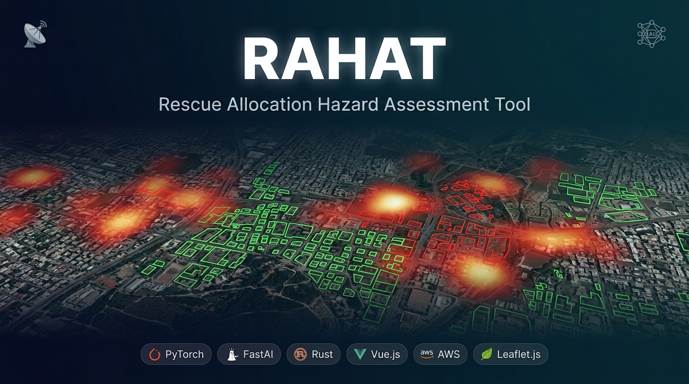
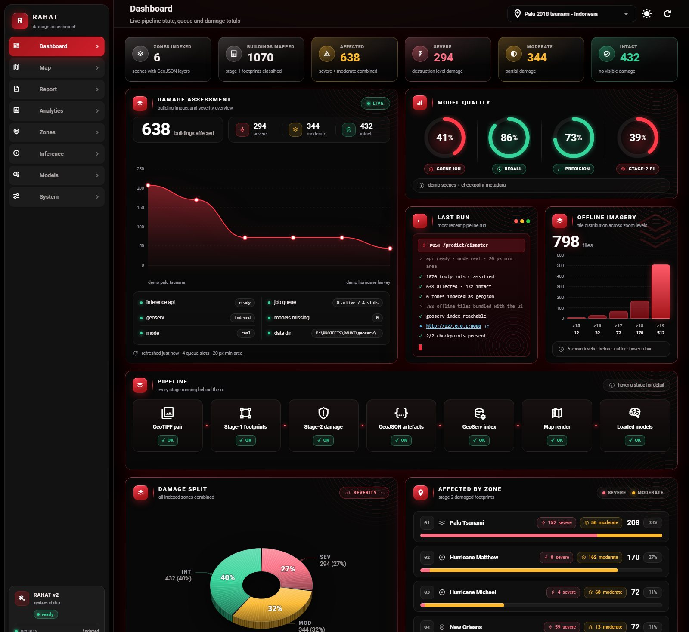
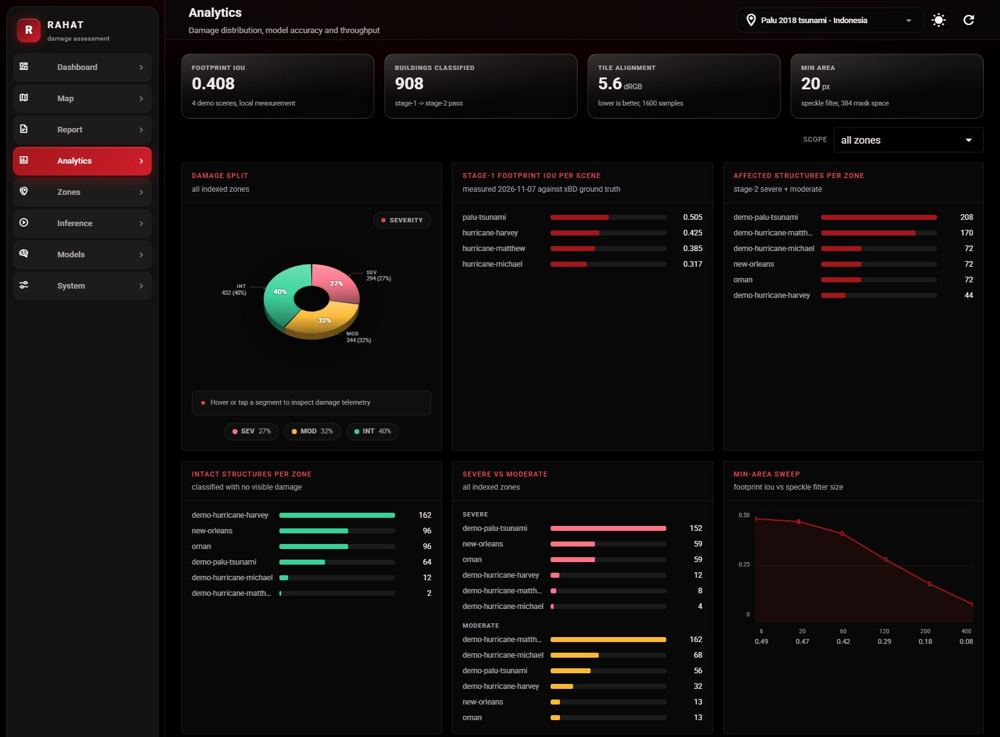
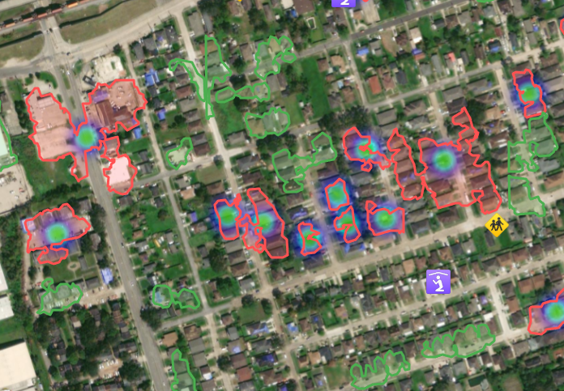
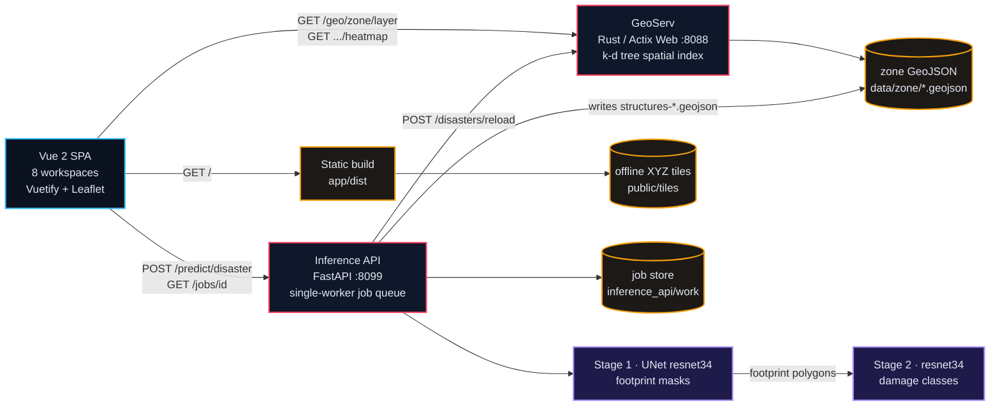
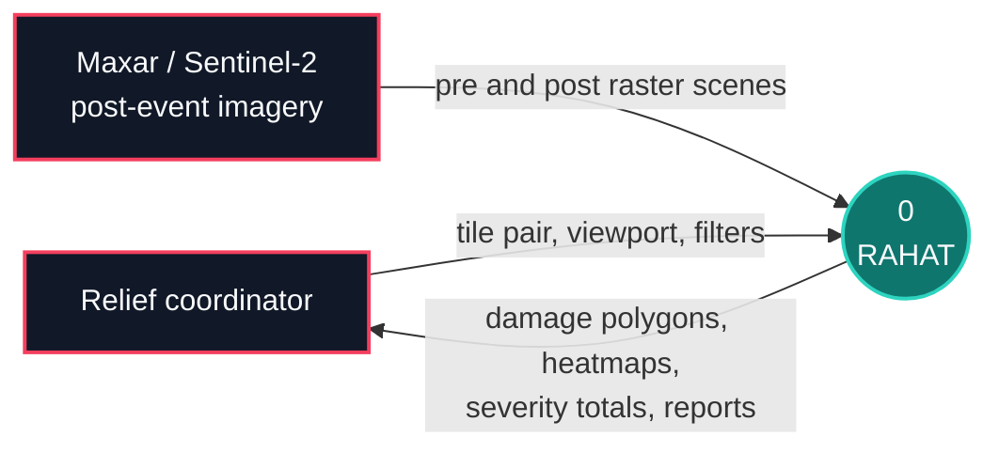
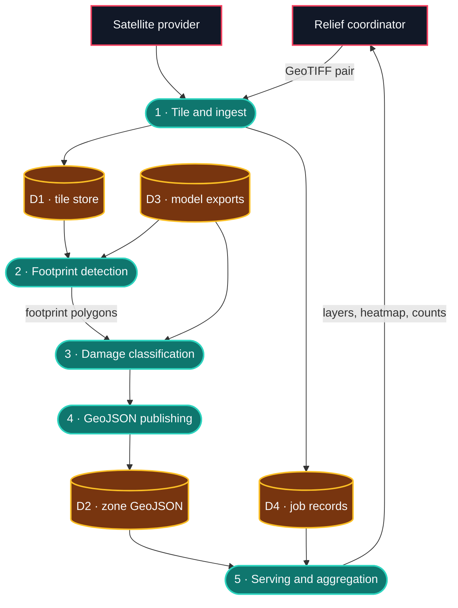
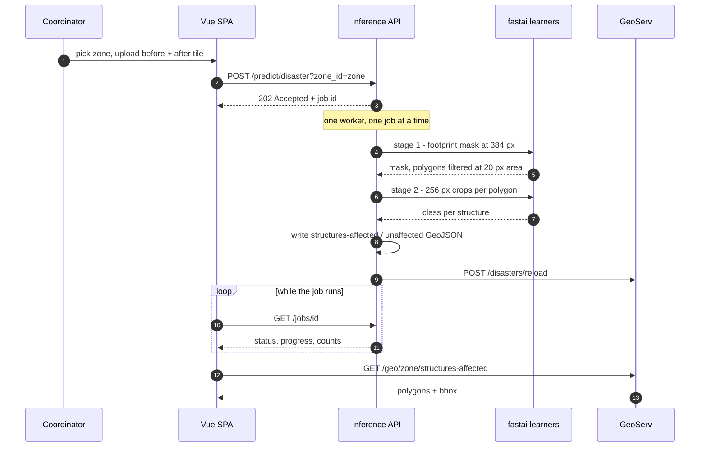
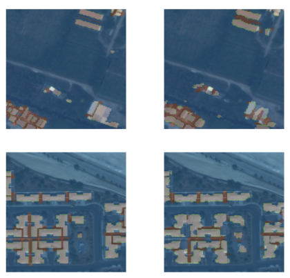
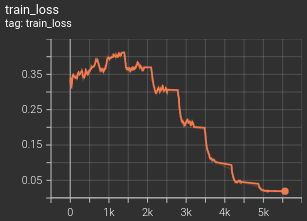

<div align="center">
  
</div>

<h1 align="center">DRISHTI</h1>

<p align="center">
  <b>Disaster Response Intelligence System with Hallucination-aware Trust Indicators</b><br>
  Unifying <b>RAHAT</b> (Rescue Allocation &amp; Hazard Assessment Tool) and <b>NETRA</b> (Sentinel-2 Super-Resolution &amp; Spectral Mapping).<br>
  Building footprint damage mapping, 4x Sentinel-2 enhancement (10m to 2.5m), hallucination-aware confidence scoring, and on-chain provenance.
</p>

<div align="center">


</div>

<p align="center">
  <a href="#overview">Overview</a> ·
  <a href="#screenshots">Screenshots</a> ·
  <a href="#feature-tour">Feature tour</a> ·
  <a href="#system-architecture">Architecture</a> ·
  <a href="#data-flow">Data flow</a> ·
  <a href="#tech-stack">Tech stack</a> ·
  <a href="#models">Models</a> ·
  <a href="#repository-layout">Layout</a> ·
  <a href="#getting-started">Getting started</a> ·
  <a href="#api-reference">API</a> ·
  <a href="#evaluation-and-known-limits">Limits</a> ·
  <a href="#roadmap">Roadmap</a>
</p>

---

## Overview

Disasters destroy buildings faster than response teams can survey them. RAHAT closes that gap by reading
pre- and post-event satellite imagery and turning it into a map a relief coordinator can actually act on:
which structures are gone, which are damaged, where damage clusters, and which critical amenities sit in
those clusters.

The platform was steered by three questions from the AWS Disaster Response Hackathon:

| Challenge | Question | How RAHAT answers it |
| --- | --- | --- |
| **SPB** | How damaged is each individual home in a disaster area? | Stage-1 UNet extracts every building footprint; stage-2 classifies each one as no-damage, minor, major or destroyed. |
| **ADB** | What is the condition of critical infrastructure, and what should be fixed first? | Affected/unaffected polygons, heatmaps and amenity layers (hospitals, fire stations, schools, shelters) are overlaid on the same map. |
| **NASA ESDS** | How can Earth observation help society respond to disasters? | The whole pipeline is driven by openly available pre/post raster scenes and runs end to end — from GeoTIFF to GeoJSON to a rendered map. |

**At a glance**

| What | Detail |
| --- | --- |
| **10** routed workspaces | Dashboard, Map, Report, Analytics, Zones, Inference, Super-Resolution, Spectral Indices, Models, System |
| **Multi-stage ML & SR** | Stage-1 footprint UNet, Stage-2 damage classifier, and 4x Sentinel-2 SR (`10m -> 2.5m`) |
| **Trust & Spectral USP** | MC-Dropout epistemic variance + SAM spectral angle + cycle-consistency hallucination masking |
| **Provenance** | Polygon Amoy (`TileProvenance.sol`, Chain ID `80002`) with SHA-256 chaining and local ledger fallback |
| **3** services | Vue SPA, Rust GeoServ, FastAPI inference + super-resolution API |
| **6** indexed zones | New Orleans, Oman + four xBD demo events (Harvey, Matthew, Michael, Palu tsunami) |
| **Offline-first** | Tiles and GeoJSON are served from disk; nothing depends on a live tile CDN at runtime |

---

## Screenshots

| Dashboard — live pipeline state | Analytics — damage distribution |
| --- | --- |
|  |  |



---

## Feature tour

Every view is a first-class workspace, not a static mock. All of them read the same diagnostics snapshot,
so the numbers agree across the app.

| Route | Workspace | What it answers |
| --- | --- | --- |
| `/` | **Dashboard** | Damage assessment totals, model quality, last run, offline tile inventory, pipeline stage-by-stage health, damage split and severity per zone. |
| `/map/:options` | **Map** | Before/after imagery, structure polygons, heatmap clusters, amenity markers, cursor readout and a shareable `@lat,lng,zoom` URL. |
| `/report` | **Report** | Per-zone damage breakdown with severity counts, share bars and the live map scope, ready to print or hand off. |
| `/analytics` | **Analytics** | Damage distribution, severity mix, model accuracy and throughput across indexed zones. |
| `/zones` | **Zones** | Every indexed scene, its layer sizes and GeoJSON feature counts. |
| `/inference` | **Inference** | Upload a before/after tile pair, queue the job and follow it to completion with live counts. |
| `/super-resolution` | **Super-Resolution** | Fetch Sentinel-2 L2A scenes via Copernicus CDSE, run 4x SR, inspect hallucination-aware trust maps, extract infrastructure, and anchor provenance. |
| `/spectral` | **Spectral Indices** | Compute NDVI, NDWI, NDBI, NBR, True Color, and False Color IR maps across native 10m and 2.5m SR imagery. |
| `/models` | **Models** | Stage-1 and stage-2 inventory, evaluation metrics and the exported learner files. |
| `/system` | **System** | Service reachability, data directories, model paths and tile inventory. |

Design notes: a shared `GlowCard`/`SectionCard` card language, a dark-first token system with a full light
theme, container-query responsive cards, and charts drawn in SVG (donut, bars, sparkline, ring gauge) with
no charting dependency.

---

## System architecture

Three processes, one contract: GeoJSON on disk. The SPA never talks to a model directly — it polls the
inference API for jobs and reads finished geometry from GeoServ.



**Why the split?**

- **GeoServ (Rust)** answers map requests in constant time. A custom static k-d tree (`kdbush`) turns a
  viewport query into a handful of candidate polygons instead of a full scan, and heatmaps are generated
  per request from the same index.
- **Inference API (Python)** is where the models live. Inference takes minutes, so the endpoint returns
  `202` with a job id and a single background worker drains the queue — the GPU is never asked to run two
  jobs at once.
- **The SPA** stays stateless: it renders whatever the two services report, which is why the dashboard,
  the map and the report can never drift apart.

---

## Data flow

### DFD level 0 — context



The single process at the centre is the whole platform: ingest, detect, classify, publish, serve.

### DFD level 1 — processes and stores



### Inference job sequence



---

## Tech stack

<table>
<tr><th align="left" width="140">Frontend</th><td>


</td></tr>
<tr><th align="left">Services</th><td>


</td></tr>
<tr><th align="left">Machine learning</th><td>


</td></tr>
<tr><th align="left">Geospatial</th><td>


</td></tr>
</table>

---

## Models

Both learners are exported with fastai `learn.export()` and unpickled by the API at job time. Nothing is
retrained at serve time, and the metrics below are the ones the app itself displays — the dashboard reads
`stage1_meta.json` and `stage2_meta.json` rather than hard-coding flattering numbers.

### Stage 1 — building footprints

| Spec | Value |
| --- | --- |
| Architecture | `unet_learner(resnet34, self_attention=True)` |
| Input | 384 px tiles |
| Mask classes | background, border, contact, footprint |
| Loss | `CombinedLoss(Focal(gamma=3) + Dice)` |
| Training | 1,949 tiles · validation 334 tiles |
| Held-out events | Hurricane Matthew, Palu tsunami |

| Metric | Score |
| --- | --- |
| Footprint IoU | **0.529** |
| Footprint recall | **0.857** |
| Footprint precision | **0.731** |
| Background IoU | 0.950 |
| Contact IoU | 0.385 |
| Border IoU | 0.224 |

The three-mask trick (interior, edges, contact points) comes from the SpaceNet-2 winners: without a
boundary channel the UNet fuses neighbouring roofs into one blob.



### Stage 2 — damage classification

| Spec | Value |
| --- | --- |
| Architecture | `cnn_learner(resnet34)` |
| Input | 256 px crops, 2 px bbox margin, aspect-preserved with black padding |
| Classes | destroyed, major-damage, minor-damage, no-damage |
| Training | 145,957 crops across 10 xBD events |
| Held-out events | Hurricane Matthew, Guatemala volcano |

| Metric | Score |
| --- | --- |
| Macro-F1, 4 classes | 0.282 |
| Macro-F1, severe merged (3 classes) | 0.389 |



### Training data

| Dataset | Used for | Licence |
| --- | --- | --- |
| [SpaceNet-2](https://spacenet.ai/spacenet-buildings-dataset-v2) | 301k labelled buildings across Las Vegas, Paris, Shanghai, Khartoum | CC BY-SA 4.0 |
| [xBD / xView2](https://xview2.org/dataset) | Pre/post pairs for 10 hurricane, monsoon and tornado events | CC BY-NC-SA 4.0 |
| [Maxar Open Data](https://www.maxar.com/open-data) | Demo zone imagery for New Orleans and Oman | Maxar terms |

Masks are written as `.png`. Before that, JPEG compression artefacts were being read as extra class
indices — a lesson that cost a debugging session.

---

## Super-Resolution, Trust Indicators & Provenance (NETRA Integration)

Alongside pre/post GeoTIFF damage classification, DRISHTI integrates the NETRA super-resolution and verification pipeline (`inference_api/backend/`):

- **Sentinel-2 CDSE Ingestion (`backend/ingestion/copernicus_client.py`)**: Fetches 10-band Sentinel-2 L2A reflectance tiles from Copernicus Data Space Ecosystem with local tile caching (`cache/tiles/`).
- **4x Neural Super-Resolution (`backend/models/sr_engine.py`)**: Enhances 10m Sentinel-2 inputs to 2.5m GSD across ONNX and PyTorch architectures (`HAT` / `EVOLAND WorldStrat`, `CARN`, `LDSR-S2`, `RRDBNet`, `SRMNet`).
- **Hallucination-Aware Trust Indicators (`backend/usp/hallucination_detector.py`)**: Combines MC-Dropout epistemic variance, Spectral Angle Mapper (SAM) deviation, low-frequency cycle-consistency residuals, and cloud-occlusion masking (`backend/preprocessing/cloud_mask.py`) to produce per-pixel confidence maps.
- **Spectral Indices & Infrastructure (`backend/spectral/spectral_indices.py`, `backend/infrastructure/detector.py`)**: Computes `NDVI`, `NDWI`, `NDBI`, and `NBR` via `spyndex` and extracts building/road layers suppressed by cloud and water masks.
- **Blockchain Provenance (`contracts/TileProvenance.sol`, `backend/blockchain/provenance_manager.py`)**: Anchors SHA-256 tile hashes, scaled coordinates (`* 1e6`), and version chains (`v1 -> v2 -> ...`) on Polygon Amoy testnet (Chain ID `80002`), falling back automatically to `cache/blockchain_ledger.json` when unconfigured.

---

## Repository layout

```text
DRISHTI/
├── app/                          Vue 2 + Vuetify SPA
│   ├── public/
│   │   ├── disaster-zones.json   zone registry the SPA renders from
│   │   ├── map/markers/          SVG amenity markers (hospital, school, shelter, ...)
│   │   └── tiles/                offline XYZ tiles shipped with the build
│   └── src/
│       ├── models/               shared TypeScript contracts
│       ├── modules/              api, format, theme, zones, utils
│       ├── store/                vuex modules (app, settings, theme)
│       ├── styles/               design tokens, tailwind layer
│       └── ui/
│           ├── components/       GlowCard, DonutChart, ZoneBars, SRComparisonSlider, ...
│           └── views/            the 10 routed workspaces
├── contracts/                    Polygon Amoy TileProvenance.sol, ABI, and deploy notes
├── geoserv/                      Rust/Actix GeoJSON + heatmap service (k-d tree index)
├── inference_api/                FastAPI job queue + integrated NETRA SR/trust backend
│   └── backend/                  CDSE ingestion, SR architectures, USP trust, spectral, blockchain
├── xview2_feature_extractor/     Rust crop extractor for xBD polygons
├── data_gen/                     tiling and dataset generation scripts
├── nbs/                          stage-1, stage-2 and inference notebooks
└── docs/                         banner, screenshots and training plots
```

---

## Getting started

### Prerequisites

| Tool | Version | Needed for |
| --- | --- | --- |
| Node.js | 16+ (the scripts set `--openssl-legacy-provider`) | SPA |
| Rust | stable (1.70+) | GeoServ, feature extractor |
| Python | 3.11 | Inference API |
| GDAL | 3.x | Tile preparation only (`data_gen/prepare_inference`) |
| CUDA | optional | Faster inference; CPU works |

### 1. GeoServ — geometry and heatmaps (port 8088)

```bash
cd geoserv
cargo run --release -- --data-dir test_data
```

`test_data` already holds the six demo zones. Each zone directory contains `amenities.geojson`,
`structures-affected.geojson` and `structures-unaffected.geojson`.

### 2. Inference API — job queue and models (port 8099)

```bash
cd inference_api
python -m venv .venv311
.venv311\Scripts\activate
pip install -r requirements.txt
uvicorn main:app --host 127.0.0.1 --port 8099
```

The two exported learners live in `inference_api/models/` (about 370 MB, not in git). Without them the
API refuses real jobs; set `RAHAT_INFER_MODE=demo` to exercise the endpoint with synthetic detections.

```bash
# geometry, GeoJSON and reload sanity check without a GPU
python infer.py --self-test
```

### 3. The web app (port 8080)

```bash
cd app
npm install
npm run serve          # runs the tailwind build first via "preserve"
```

Open <http://127.0.0.1:8080>. The dev server proxies `/api/*` to `127.0.0.1:8099` (no CORS middleware on
the API), and reads zone geometry straight from GeoServ.

```bash
npm run build          # production bundle in app/dist
npm run lint           # eslint + vue rules
```

### Configuration

| Variable | Default | Purpose |
| --- | --- | --- |
| `RAHAT_INFER_MODE` | `real` | `real` runs the models, `demo` writes synthetic detections |
| `RAHAT_DATA_DIR` | `geoserv/test_data` | where per-zone GeoJSON is read and written |
| `RAHAT_WORK_DIR` | `inference_api/work` | uploaded tiles and job records |
| `RAHAT_MODEL_DIR` | `inference_api/models` | the two exported fastai learners |
| `RAHAT_GEOSERV_URL` | `http://127.0.0.1:8088` | reload target after a job |
| `RAHAT_DEVICE` | export default | `cpu`, `cuda` or a device index |
| `RAHAT_MAX_UPLOAD_MB` | `512` | per-file upload cap |
| `RAHAT_MAX_JOBS` | `4` | queued plus running jobs |
| `RAHAT_MIN_AREA` | `20` | speckle filter, in 384-space mask pixels |

---

## API reference

### Inference API `:8099`

| Method | Endpoint | Purpose |
| --- | --- | --- |
| `GET` | `/health` | mode, model file presence, GeoServ reachability |
| `GET` | `/diagnostics` | read-only snapshot the dashboard, zones and system views render |
| `POST` | `/predict/disaster?zone_id={zone}` | multipart `before_image` + `after_image`, returns `202` with a job id |
| `GET` | `/jobs?limit=20` | most recent jobs, newest first |
| `GET` | `/jobs/{job_id}` | status, progress and damage counts |
| `GET` | `/docs` | generated OpenAPI UI |

### GeoServ `:8088`

| Method | Endpoint | Purpose |
| --- | --- | --- |
| `GET` | `/geo/{zone}/{layer}` | GeoJSON for `amenities`, `structures-affected`, `structures-unaffected` |
| `GET` | `/geo/{zone}/{layer}/heatmap` | weight points generated from the same layer |
| `GET` | `/disasters/zones` | every zone directory the server indexed |
| `POST` | `/disasters/reload` | re-index after new GeoJSON lands on disk |

Output follows RFC 7946 and carries a `bbox` per feature — the browser uses it for hit-testing and for
fitting the map to a selection.

```json
{
  "type": "FeatureCollection",
  "features": [
    {
      "id": "0",
      "type": "Feature",
      "properties": { "damage": "destroyed" },
      "geometry": {
        "type": "Polygon",
        "coordinates": [[[-90.02615, 29.95925], [-90.02622, 29.95927], [-90.02615, 29.95925]]]
      },
      "bbox": [-90.026356, 29.959251, -90.026011, 29.959607]
    }
  ]
}
```

---

## Data preparation

| Script | Job |
| --- | --- |
| `data_gen/prepare_inference/create_tiles.py` | cuts a wide scene into a shared before/after tile grid |
| `data_gen/prepare_inference/split_geotifs_by_band.py` | splits multi-band rasters for the tile server |
| `data_gen/stage_1/generate_stage_1_data.py` | builds the three-channel footprint masks |
| `data_gen/stage_2/generate_data.py` | crops per-building chips for the damage classifier |
| `xview2_feature_extractor` | Rust equivalent of the stage-2 crop pass, roughly two orders of magnitude faster |

The Conda environment for the data scripts lives in `data_gen/env.yml`; the SageMaker environment is
`nbs/ml_env_sagemaker.yml`.

```bash
conda env create -n ml_env_sagemaker python=3.8 -f nbs/ml_env_sagemaker.yml
```

[](https://studiolab.sagemaker.aws/import/github/kiyansh13karan/RAHAT---Rescue-Allocation-Hazard-Assessment-Tool/blob/main/nbs/stage_1_building_detect.ipynb)
[](https://studiolab.sagemaker.aws/import/github/kiyansh13karan/RAHAT---Rescue-Allocation-Hazard-Assessment-Tool/blob/main/nbs/stage_2_building_damage.ipynb)

---

## Evaluation and known limits

The honest version, because relief decisions deserve one.

- **Severity is directional, not survey grade.** Stage 2 reaches a macro-F1 of 0.28 across four xBD
  classes; merging `destroyed` and `major-damage` into "severe" lifts it to 0.39. Treat the map as a
  prioritisation aid and confirm before committing resources.
- **Sparse settlements are the weak spot.** Stage 1 performs best over dense urban blocks and clumps
  neighbouring roofs in low-density residential areas.
- **Off-axis and blurry post-event imagery breaks the comparison.** The Oman test produced excellent
  footprints and poor damage calls because the after-image was blurrier and shifted relative to the
  before-image. This is the class of error a siamese network is designed to absorb.
- **Clouds and blue tarpaulins are read as damage.** Both are in the roadmap below; neither is solved.
- **One tile pair per job.** A 30,000 px scene has to be cut into tiles first; the API takes tiles, not
  scenes.

---

## Roadmap

- Retrain stage 2 as a siamese network on aligned before/after pairs.
- Add cloud and tarpaulin negatives to both training sets.
- Batch GPU inference with a real queue instead of a single worker thread.
- Feed new Sentinel-2 flyovers in automatically from its public SNS topic.
- Ship a Docker Compose stack so the three services start with one command.

---

## Links

- Video presentation: <https://www.youtube.com/watch?v=-5hXBvW52yg>
- Presentation slides: <https://drive.google.com/file/d/12LegGG3HfVoSOfvyOF04m8-C4C3N-VtI/view>
- Component notes: [GeoServ](geoserv/README.md) · [Web app](app/README.md) · [Feature extractor](xview2_feature_extractor/README.md)

## Credits

RAHAT builds on the disaster response viewer created by
[Rico A. Beti and Stephen Mott](https://silentbyte.com) for the
[AWS Disaster Response Hackathon](https://awsdisasterresponse.devpost.com/). The Vue shell, GeoServ and the
original training notebooks are theirs; the dashboard, analytics, inference queue and the model retraining
are built on top of it. Maintained by [Karan Nayal](https://github.com/kiyansh13karan).

Training data belongs to its publishers: SpaceNet-2 (CC BY-SA 4.0), xBD (CC BY-NC-SA 4.0) and the Maxar
Open Data Program. Check those licences before redistributing imagery or weights.

## License

[MIT](LICENSE.txt) © 2022 Rico A. Beti &amp; Stephen Mott
